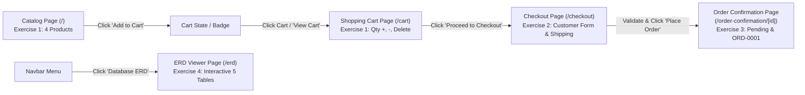
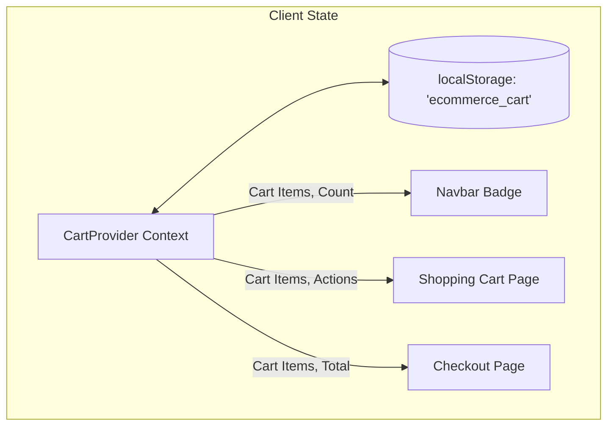

# 🏗️ SYSTEM ARCHITECTURE & TECHNICAL BLUEPRINT

## 1. Project Overview & Scope
This project is an e-commerce web application built strictly according to the specifications in **`លំហាត់អនុវត្ត.pdf`**, covering all four practical exercises:
- **Exercise 1 (Slide 26)**: Product catalog displaying 4 products (Laptop $650, Mouse $15, Keyboard $25, Monitor $120), Add to Cart button, interactive Shopping Cart page with QTY increment/decrement, remove item, subtotal and grand total calculation, and "Proceed to Checkout" button.
- **Exercise 2 (Slide 27)**: Modern Checkout form capturing Customer Details (First Name, Last Name, Email, Phone, Street Address, City, State, Zip Code), form validation with real-time error hints, Shipping Method selector (Free $0 [7-20 Days], Express $9 [1-3 Days]), dynamic Order Summary calculation, and "Place Order" button.
- **Exercise 3 (Slide 28)**: Order Confirmation screen showing:
  - "Order Placed Successfully!" (ការបញ្ជាទិញទទួលបានជោគជ័យ!)
  - Order ID (e.g. `ORD-0001`)
  - Customer Name
  - Order Date
  - Ordered Products (Itemized table: name, unit price, quantity, line total)
  - Grand Total
  - Order Status: `"Pending"`
- **Exercise 4 (Database Design Slide)**: Relational Database Design with ERD modeling 5 tables: `Customers`, `Categories`, `Products`, `Orders`, `Order_Items`. Included as both documentation and an interactive visual viewer at `/erd`.

---

## 2. Technology Stack

| Layer | Technology | Justification |
| :--- | :--- | :--- |
| **Framework** | Next.js 14 (App Router) | High-performance React 18 framework with server & client components, API route handlers, and SEO optimization. |
| **Language** | TypeScript 5 | Strict static typing, type safety for API contracts, and robust interfaces. |
| **Styling** | Tailwind CSS 3 | Rapid, utility-first modern responsive UI styling matching the exercise screenshots. |
| **Icons** | Lucide React | High quality icons (shopping cart, trash, plus, minus, check, credit card, database, user, truck). |
| **Database ORM** | Prisma 5 + SQLite | Lightweight, zero-config relational database perfect for local execution and fast seed loading. |
| **State Management** | React Context + LocalStorage | Reactive cart state management with instant updates and local storage persistence. |
| **Visual Effects** | canvas-confetti | Celebration confetti upon successful order placement on Slide 28. |

---

## 3. Directory Layout & Folder Structure

```
├── DATABASE_DESIGN.md       # Relational Database Documentation & ERD
├── API_SPEC.md              # REST API Specification & Payloads
├── ARCHITECTURE.md          # Architecture & Page Routing Blueprint
├── prisma/
│   ├── schema.prisma        # 5 Entities: Customer, Category, Product, Order, OrderItem
│   ├── seed.ts              # Seeds 4 initial products, categories, demo customer
│   └── dev.db               # SQLite database file
├── src/
│   ├── app/
│   │   ├── layout.tsx       # Root layout with CartProvider, Header, Footer
│   │   ├── page.tsx         # Home / Shop Catalog (Exercise 1)
│   │   ├── cart/
│   │   │   └── page.tsx     # Shopping Cart Page (Exercise 1)
│   │   ├── checkout/
│   │   │   └── page.tsx     # Checkout Page with Customer Form & Summary (Exercise 2)
│   │   ├── order-confirmation/
│   │   │   └── [orderNumber]/
│   │   │       └── page.tsx # Order Confirmation Screen (Exercise 3)
│   │   ├── orders/
│   │   │   └── page.tsx     # All Orders List / History
│   │   ├── erd/
│   │   │   └── page.tsx     # Interactive Visual ERD & Database Model (Exercise 4)
│   │   └── api/
│   │       ├── products/
│   │       │   └── route.ts # GET /api/products
│   │       ├── orders/
│   │       │   ├── route.ts # POST /api/orders, GET /api/orders
│   │       │   └── [orderNumber]/
│   │       │       └── route.ts # GET /api/orders/[orderNumber]
│   │       └── schema/
│   │           └── route.ts # GET /api/schema
│   ├── components/
│   │   ├── navbar.tsx       # Top Navigation with logo, links, and Cart badge
│   │   ├── footer.tsx       # Clean footer with Khmer & English credits
│   │   ├── product-card.tsx # Catalog product card with "Add to Cart"
│   │   ├── cart-item.tsx    # Cart table row with (+, -, delete) controls
│   │   ├── order-summary.tsx# Reusable Order Summary sidebar
│   │   └── erd-diagram.tsx  # Interactive visual ERD renderer with tables
│   ├── context/
│   │   └── cart-context.tsx # React Context for cart items, add, update, remove, clear
│   ├── lib/
│   │   ├── prisma.ts        # Prisma Client singleton
│   │   └── utils.ts         # Formatting utilities (currency $, dates, order number)
│   └── types/
│       └── index.ts         # TypeScript interfaces for Product, Customer, Order, CartItem
```

---

## 4. User Journeys & Route Flows



### Flow 1: Practical Exercise 1 - Catalog to Cart
1. User lands on `/` (or clicks "Shop").
2. 4 products are fetched from `/api/products`:
   - **Laptop**: $650.00
   - **Mouse**: $15.00
   - **Keyboard**: $25.00
   - **Monitor**: $120.00
3. Clicking **Add to Cart** updates `CartContext`, increases cart badge in the Navbar, and triggers a brief toast/notification.
4. User navigates to `/cart`:
   - Visual itemized table displays items with product photo, title, price, quantity controls (`+` and `-`), line item total, and trash button.
   - Subtotal and Grand Total update dynamically in real time.
   - Minimum quantity is 1; clicking `-` at 1 prompts for removal or keeps at 1. Clicking trash icon deletes the item.
   - Clicking **"Proceed to Checkout"** routes to `/checkout`.

### Flow 2: Practical Exercise 2 - Checkout Form & Order Summary
1. At `/checkout`, the layout mirrors the reference screenshot:
   - **Left Column**: Customer Information form:
     - First Name (required)
     - Last Name (required)
     - Email (required, email validation)
     - Phone Number (required)
     - Street Address (required)
     - City, State, Zip Code (required)
     - Shipping Method Selector:
       - Free Shipping ($0.00) [7-20 Days]
       - Express Shipping ($9.00) [1-3 Days]
   - **Right Column**: Sticky Order Summary card:
     - Thumbnail preview of items with quantity badges
     - Subtotal
     - Shipping cost ($0 or $9 based on user radio selection)
     - Tax ($0.00)
     - Grand Total (`Subtotal + Shipping`)
     - **Place Order** button with loading state.
2. Clicking "Place Order" triggers form validation. If any field is blank, clear red error messages appear next to inputs.
3. When valid, client sends `POST /api/orders`. Backend creates customer (if new), creates order with sequential number (e.g. `ORD-0001`), creates `order_items`, and returns status `"Pending"`.
4. Client clears cart and redirects to `/order-confirmation/ORD-0001`.

### Flow 3: Practical Exercise 3 - Order Confirmation (Slide 28)
1. At `/order-confirmation/[orderNumber]`:
   - Green success checkmark banner: **"Order Placed Successfully!"**
   - **Order ID**: e.g., `ORD-0001`
   - **Customer Name**: First Name + Last Name
   - **Order Date**: Formatted date
   - **Ordered Products Table**: Product Name, Quantity, Unit Price, Line Total
   - **Total Amount**: Grand Total in USD
   - **Order Status Badge**: `"Pending"` (with amber badge)
   - Action buttons: "Print Invoice / Receipt" and "Continue Shopping".

### Flow 4: Practical Exercise 4 - Database Design & ERD Viewer
1. At `/erd`:
   - An interactive visual presentation of the 5 tables (`Customers`, `Categories`, `Products`, `Orders`, `Order_Items`).
   - Visual diagram cards showing PK, FK, column names, and data types.
   - Clear explanations of cardinalities (1:N Category -> Product, 1:N Customer -> Order, 1:N Order -> OrderItem, 1:N Product -> OrderItem).
   - Embedded Mermaid diagram and copyable Prisma schema / SQL DDL.

---

## 5. Client State Management Architecture



`CartContext` exports:
- `items`: `CartItem[]` (contains `productId`, `name`, `price`, `imageUrl`, `quantity`)
- `addToCart(product, quantity?)`: void
- `updateQuantity(productId, quantity)`: void
- `removeFromCart(productId)`: void
- `clearCart()`: void
- `subtotal`: number
- `totalItems`: number
