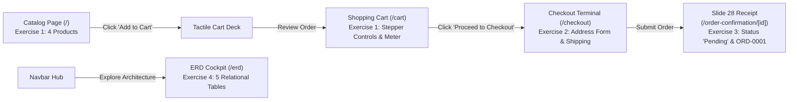

# 🏗️ SYSTEM ARCHITECTURE & TECHNICAL BLUEPRINT
## Rebuilt for "Cyber-Tactile Industrial Luxe" (2026 Edition)

---

## 1. Project Overview & Scope
This project is an advanced e-commerce web application built strictly according to the specifications in **`លំហាត់អនុវត្ត.pdf`**, covering all four practical exercises with an upgraded, modern, distinctive **Cyber-Tactile Industrial Luxe** visual identity:

- **Exercise 1 (Slide 26)**:
  - Product catalog featuring 4 official hardware products:
    - **Laptop**: `$650.00`
    - **Mouse**: `$15.00`
    - **Keyboard**: `$25.00`
    - **Monitor**: `$120.00`
  - Tactile "Add to Cart" interactions with spring feedback and instant floating HUD notification.
  - Interactive Shopping Cart page with QTY increment/decrement (`+` / `-`), remove item, dynamic subtotal, free shipping progress meter, and "Proceed to Checkout" button.
- **Exercise 2 (Slide 27)**:
  - Modern Checkout form capturing Customer Details: First Name, Last Name, Email, Phone, Street Address, City, State, Zip Code.
  - Real-time field validation with visual cues (green check on valid, crimson warning on invalid).
  - Shipping Method selector:
    - **Free Shipping ($0.00)** [7–20 Business Days]
    - **Express Shipping ($9.00)** [1–3 Business Days]
  - 1-Click Auto-Fill Demo student button for instant grading.
  - Dynamic Order Summary and Grand Total calculation (`Subtotal + Shipping`).
  - "Place Order" button.
- **Exercise 3 (Slide 28)**:
  - Order Confirmation screen designed as an **Industrial Cryptographic Dispatch Receipt**:
    - Headline: **"Order Placed Successfully!"**
    - **Order ID** (e.g. `ORD-0001`) with copy function
    - **Customer Name**
    - **Order Date**
    - **Ordered Products Table** with historical price snapshots
    - **Total Amount**
    - **Order Status Badge**: `"Pending"`
    - Confetti celebration burst and printable invoice manifest.
- **Exercise 4 (Database Design Slide)**:
  - Relational Database Design with ERD modeling 5 tables in 3NF: `customers`, `categories`, `products`, `orders`, `order_items`.
  - Interactive visual ERD studio at `/erd` with live database stats, SQL DDL export, Prisma schema view, and native `diagrams.net` (`.drawio`) deep integration.

---

## 2. Technology Stack & Design Architecture

| Layer | Technology | Role & Implementation |
| :--- | :--- | :--- |
| **Framework** | Next.js 14 (App Router) | High-performance React 18 framework with App Router, server & client components, API route handlers. |
| **Language** | TypeScript 5 | Strict static typing, type safety for API contracts, and robust interfaces. |
| **Styling & Archetype** | Tailwind CSS 3 | Cyber-Tactile Industrial Luxe (Teenage Engineering x Linear aesthetic, dot-grid canvas, chamfered borders). |
| **Icons** | Lucide React | High-precision vector iconography. |
| **Database ORM** | Prisma 5 + SQLite | Lightweight, relational database in 3rd Normal Form (3NF) with foreign key cascades. |
| **State Management** | React Context + LocalStorage | Resilient cart state with instant reactive synchronization and local storage persistence. |
| **Visual Effects** | canvas-confetti | Celebration confetti particle burst on Slide 28 confirmation screen. |

---

## 3. Directory Layout & Folder Structure

```
├── DATABASE_DESIGN.md            # Relational Database Documentation & ERD
├── API_SPEC.md                   # REST API Specification & Payloads
├── ARCHITECTURE.md               # Architecture & Page Routing Blueprint
├── prisma/
│   ├── schema.prisma             # 5 Entities: Customer, Category, Product, Order, OrderItem
│   ├── seed.ts                   # Seeds 4 initial products, categories, demo customer
│   └── dev.db                    # SQLite database file
├── src/
│   ├── app/
│   │   ├── layout.tsx            # Master layout with CartProvider, Floating Deck Navbar, Footer
│   │   ├── page.tsx              # Home / Bento Hardware Catalog (Exercise 1)
│   │   ├── cart/
│   │   │   └── page.tsx          # Shopping Cart with Steppers & Shipping Meter (Exercise 1)
│   │   ├── checkout/
│   │   │   └── page.tsx          # Checkout Terminal & Address Form (Exercise 2)
│   │   ├── order-confirmation/
│   │   │   └── [orderNumber]/
│   │   │       ├── page.tsx      # Static export params
│   │   │       └── OrderConfirmationClient.tsx # Industrial Dispatch Manifest (Slide 28)
│   │   ├── orders/
│   │   │   └── page.tsx          # Submitted Orders Log & History
│   │   ├── erd/
│   │   │   └── page.tsx          # Relational 3NF Database Cockpit & draw.io Hub (Exercise 4)
│   │   └── api/
│   │       ├── products/route.ts # GET /api/products
│   │       ├── orders/
│   │       │   ├── route.ts      # POST /api/orders, GET /api/orders
│   │       │   └── [orderNumber]/route.ts # GET /api/orders/[orderNumber]
│   │       └── schema/route.ts   # GET /api/schema
│   ├── components/
│   │   ├── navbar.tsx            # Floating Aerospace Navigation Deck
│   │   ├── footer.tsx            # Industrial Hardware Store Footer & Tech Manifest
│   │   ├── product-card.tsx      # Cyber-Tactile Hardware Card (Stock heartbeat, Quick View)
│   │   └── ...                   # Specialized UI components
│   ├── context/
│   │   └── cart-context.tsx      # React Context for cart items, add, update, remove, clear
│   ├── lib/
│   │   ├── prisma.ts             # Prisma Client singleton
│   │   └── utils.ts              # Formatting utilities (currency $, dates, order number)
│   └── types/
│       └── index.ts              # TypeScript interfaces
```

---

## 4. User Journey & Architectural Flow



---

## 5. Team Delegation & Responsibility Matrix

| Agent | Focus Area | Specific Responsibilities |
| :--- | :--- | :--- |
| **`@architect`** | System Architecture | Architectural structure, component hierarchy, design archetype definition, specifications. |
| **`@designer`** | UI/UX & Visual System | Color tokens, typography, bento grid layout, tactile micro-interaction states, interactive prototypes. |
| **`@frontend`** | Client Engineering | Tailwind token implementation, App Router page rebuilds, client state wiring, responsive views, zero build errors. |
| **`@reviewer`** | QA & Polish Audit | Verification against `លំហាត់អនុវត្ត.pdf` Slides 26-28, form validation, responsiveness, and clean console logs. |
