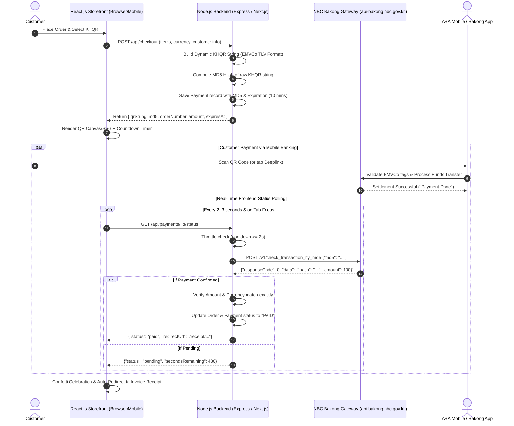

# Complete Guide to Bakong KHQR Payment Integration (React.js & Node.js)

This guide documents the end-to-end integration of **Bakong KHQR Dynamic Payment QR Codes** for modern full-stack JavaScript / TypeScript applications (**Node.js Backend** and **React.js Frontend**), based on the official National Bank of Cambodia (NBC) and EMVCo Merchant-Presented Mode specifications.

---

## 1. Architecture & Payment Flow



---

## 2. Prerequisites & Credentials

To accept payments and verify settlements, you need:

1. **Bakong Account ID**:
   - **Individual Wallet**: e.g., `your_name@bkrt` (from the official Bakong app) or `username@abaa` (from ABA Bank).
   - **Merchant Account**: Assigned by your partner commercial bank (e.g., ABA, Canadia, ACLEDA, Sathapana) when opening a merchant acquiring account.
2. **Bakong Developer Token (JWT)**:
   - Generated from the official **[Bakong Developer Portal](https://bakong.nbc.gov.kh/developer/)**.
   - A JWT Bearer token: `eyJhbGciOiJIUzI1NiIsInR5cCI6IkpXVCJ9...`
   - Included in the `Authorization: Bearer <TOKEN>` header to query transaction status from the NBC gateway.

---

## 3. Environment & Configuration Setup

### `.env`
```env
# Bakong KHQR Credentials
BAKONG_TOKEN="eyJhbGciOiJIUzI1NiIsInR5cCI6IkpXVCJ9..."
BAKONG_ACCOUNT_ID="your_wallet@bkrt"
BAKONG_MERCHANT_NAME="My Store Name"
BAKONG_MERCHANT_CITY="Phnom Penh"
BAKONG_CURRENCY="KHR"               # Primary currency: 'KHR' or 'USD'
BAKONG_QR_TTL_SECONDS=600           # 10 minutes validity window
BAKONG_API_URL="https://api-bakong.nbc.gov.kh/v1"
BAKONG_MOCK=false                   # Set true for local offline simulation
```

### `config/bakong.ts`
```typescript
export const bakongConfig = {
  token: process.env.BAKONG_TOKEN || '',
  accountId: process.env.BAKONG_ACCOUNT_ID || 'your_wallet@bkrt',
  merchantName: (process.env.BAKONG_MERCHANT_NAME || 'My Store').slice(0, 25),
  merchantCity: (process.env.BAKONG_MERCHANT_CITY || 'Phnom Penh').slice(0, 15),
  currency: (process.env.BAKONG_CURRENCY || 'KHR').toUpperCase() as 'KHR' | 'USD',
  qrTtlSeconds: parseInt(process.env.BAKONG_QR_TTL_SECONDS || '600', 10),
  apiUrl: process.env.BAKONG_API_URL || 'https://api-bakong.nbc.gov.kh/v1',
  mock: process.env.BAKONG_MOCK === 'true',
};
```

---

## 4. EMVCo TLV Format & Tag Breakdown

Bakong KHQR strictly implements the **EMVCo Merchant-Presented Mode** using the **Tag-Length-Value (TLV)** standard:
- **Tag**: 2 digits (e.g. `'00'`)
- **Length**: 2 digits with zero padding (e.g. `'02'`)
- **Value**: String payload of that exact length (e.g. `'01'`)

### Complete Tag Breakdown for Dynamic KHQR

| Tag | Name | Type | Value / Implementation Rule |
| :--- | :--- | :--- | :--- |
| `00` | Payload Format Indicator | String | Fixed: `'01'` |
| `01` | Point of Initiation Method | String | `'12'` (Dynamic QR with fixed amount & expiry) |
| `29` | Individual Account Info | Subtag `00` | Receiver Bakong Account ID (e.g. `your_wallet@bkrt`). *Do not include store labels for Tag 29!* |
| `30` | Merchant Account Info | Subtags | Used only when registered as an official corporate merchant with bank codes. |
| `52` | Merchant Category Code | String | `'5999'` (General Retail) |
| `53` | Transaction Currency | String | ISO 4217 numeric: `'116'` for **KHR**, `'840'` for **USD** |
| `54` | Transaction Amount | String | **KHR**: Integer string with NO decimals (e.g. `'41000'`).<br>**USD**: Exactly 2 decimals (e.g. `'10.50'`). |
| `58` | Country Code | String | `'KH'` (Cambodia) |
| `59` | Merchant Name | String | Up to 25 clean ASCII characters (e.g. `'MY STORE'`) |
| `60` | Merchant City | String | Up to 15 clean ASCII characters (e.g. `'Phnom Penh'`) |
| `62` | Additional Data Template | Subtag `01` | Clean alphanumeric Bill / Order Number (strip `#`, `&`, etc.) |
| `99` | Timestamp Template (**CRITICAL**) | Subtags `00` & `01` | **Subtag 00**: Creation timestamp in milliseconds (13 digits).<br>**Subtag 01**: Expiration timestamp in milliseconds (13 digits).<br>*(Missing Subtag 01 triggers ABA Mobile rejection: `[MAPP-KHQR-INV-FORMAT]`)* |
| `63` | CRC-16 Checksum | String | 4-digit uppercase hex computed using EMVCo CCITT polynomial `0x1021`, initial value `0xFFFF` over `payload + "6304"`. |

---

## 5. Critical Lessons & Pitfalls to Avoid

### ⚠️ Pitfall 1: Tag 99 Expiration Subtag (ABA Mobile Rejection)
- **The Issue**: Many legacy packages only include Subtag `00` (Creation ms) in Tag 99.
- **The Error**: ABA Mobile and banking apps reject the QR with `[MAPP-KHQR-INV-FORMAT]` ("Invalid QR code. Please ask receiver to present a new QR code").
- **The Fix**: Tag 99 **MUST** include both:
  - Subtag `00`: 13-digit Unix creation timestamp in ms (`Date.now()`).
  - Subtag `01`: 13-digit Unix expiration timestamp in ms (`Date.now() + ttlMs`).

```typescript
const nowMs = Date.now().toString();
const expiresMs = (Date.now() + ttlSeconds * 1000).toString();
const subTag00 = tlv('00', nowMs);
const subTag01 = tlv('01', expiresMs);
const tag99 = tlv('99', subTag00 + subTag01); // Combined length is 34
```

### ⚠️ Pitfall 2: Individual Wallet (`Tag 29`) vs Merchant Account (`Tag 30`)
- If using a personal or individual wallet (`username@bkrt` / `Tag 29`), **never include store label (`03`) or terminal label (`07`) inside Tag 62**.
- Banks like ABA validate the schema strictly: terminal labels inside Tag 62 for an individual wallet cause schema validation failures.
- Only pass Subtag `01` (Order Number) in Tag 62 for individual accounts.

### ⚠️ Pitfall 3: Currency & Decimals
- **KHR (`116`)**: Must be an **integer string** with NO decimals (e.g. `'41000'`, not `'41000.00'`).
- **USD (`840`)**: Must have **exactly 2 decimal places** (e.g. `'10.50'`, not `'10.5'`).

### ⚠️ Pitfall 4: Gateway Polling Rate Limiting
- Polling the NBC gateway too frequently can trigger rate limits or IP bans.
- Enforce a **server-side throttling check** ensuring at least **2.0 seconds** have passed since `lastCheckedAt` before querying NBC.

---

## 6. Complete Node.js Backend Service

Create `src/services/BakongService.ts` (or `lib/bakong.ts`):

```typescript
import crypto from 'crypto';

export interface DynamicKhqrResult {
  qrString: string;
  md5: string;
  expiresAt: Date;
  deeplink: string;
}

export interface SettlementCheckResult {
  paid: boolean;
  data?: any;
  error?: string;
}

export class BakongService {
  private token: string;
  private accountId: string;
  private merchantName: string;
  private merchantCity: string;
  private ttlSeconds: number;
  private apiUrl: string;
  private mock: boolean;

  constructor(config: {
    token?: string;
    accountId: string;
    merchantName?: string;
    merchantCity?: string;
    ttlSeconds?: number;
    apiUrl?: string;
    mock?: boolean;
  }) {
    this.token = config.token || '';
    this.accountId = config.accountId;
    this.merchantName = (config.merchantName || 'STORE').slice(0, 25);
    this.merchantCity = (config.merchantCity || 'Phnom Penh').slice(0, 15);
    this.ttlSeconds = config.ttlSeconds || 600;
    this.apiUrl = config.apiUrl || 'https://api-bakong.nbc.gov.kh/v1';
    this.mock = config.mock ?? false;
  }

  /**
   * Encodes a Tag, Length, and Value into the EMVCo TLV string.
   */
  public tlv(tag: string, value: string): string {
    const formattedTag = tag.padStart(2, '0');
    const length = value.length.toString().padStart(2, '0');
    return `${formattedTag}${length}${value}`;
  }

  /**
   * Generates a dynamic KHQR string, calculates MD5 hash, and mobile deeplink.
   */
  public generateDynamicKhqr(
    orderNumber: string,
    amount: number,
    currency: 'KHR' | 'USD' = 'KHR'
  ): DynamicKhqrResult {
    const isKhr = currency.toUpperCase() === 'KHR';
    const currencyCode = isKhr ? '116' : '840';

    // Amount formatting: integer string for KHR, 2 decimals for USD
    const formattedAmount = isKhr
      ? Math.round(amount).toString()
      : amount.toFixed(2);

    // 1. Tag 00: Payload Format Indicator ('01')
    let payload = this.tlv('00', '01');

    // 2. Tag 01: Point of Initiation Method ('12' = Dynamic QR)
    payload += this.tlv('01', '12');

    // 3. Tag 29: Individual Account Info (Subtag 00 = Bakong ID)
    const subTag29 = this.tlv('00', this.accountId);
    payload += this.tlv('29', subTag29);

    // 4. Standard Merchant Tags
    payload += this.tlv('52', '5999'); // Merchant Category Code
    payload += this.tlv('53', currencyCode);
    payload += this.tlv('54', formattedAmount);
    payload += this.tlv('58', 'KH'); // Country Code
    payload += this.tlv('59', this.merchantName);
    payload += this.tlv('60', this.merchantCity);

    // 5. Tag 62: Clean Order Reference (Subtag 01)
    const cleanOrderNumber = orderNumber.replace(/[^A-Za-z0-9\-]/g, '');
    const subTag62 = this.tlv('01', cleanOrderNumber);
    payload += this.tlv('62', subTag62);

    // 6. Tag 99: Creation & Expiration Timestamps in MS (CRITICAL)
    const nowMs = Date.now().toString();
    const expiresMs = (Date.now() + this.ttlSeconds * 1000).toString();
    const subTag99 = this.tlv('00', nowMs) + this.tlv('01', expiresMs);
    payload += this.tlv('99', subTag99);

    // 7. Tag 63: CRC-16 CCITT Checksum
    const prefix = payload + '6304';
    const crc = this.calculateCrc16(prefix);
    const finalKhqrString = prefix + crc;

    // 8. 32-Character MD5 Hash for NBC Gateway Query
    const md5Hash = crypto
      .createHash('md5')
      .update(finalKhqrString)
      .digest('hex');

    // 9. Mobile Banking Deeplink
    const deeplink = `bakong://qr?data=${encodeURIComponent(finalKhqrString)}`;

    return {
      qrString: finalKhqrString,
      md5: md5Hash,
      expiresAt: new Date(Date.now() + this.ttlSeconds * 1000),
      deeplink,
    };
  }

  /**
   * Queries NBC Bakong Gateway to check settlement status by MD5 hash.
   */
  public async checkTransaction(
    md5Hash: string,
    expectedAmount: number,
    expectedCurrency: string
  ): Promise<SettlementCheckResult> {
    // If mock mode is active, check local mock store
    if (this.mock) {
      return this.checkMockTransaction(md5Hash);
    }

    try {
      const response = await fetch(`${this.apiUrl}/check_transaction_by_md5`, {
        method: 'POST',
        headers: {
          'Content-Type': 'application/json',
          Authorization: `Bearer ${this.token}`,
        },
        body: JSON.stringify({ md5: md5Hash }),
      });

      if (!response.ok) {
        return { paid: false, error: `Gateway returned status ${response.status}` };
      }

      const body = await response.json();

      // responseCode 0 indicates successful settlement
      if (body.responseCode === 0 && body.data) {
        const tx = body.data;
        const actualAmount = parseFloat(tx.amount || '0');
        const actualCurrency = (tx.currency || '').toUpperCase();

        // Strict verification of amount and currency
        const isAmountMatch = Math.abs(actualAmount - expectedAmount) < 0.01;
        const isCurrencyMatch = actualCurrency === expectedCurrency.toUpperCase();

        if (isAmountMatch && isCurrencyMatch) {
          return { paid: true, data: tx };
        }
      }

      return { paid: false, data: body };
    } catch (err: any) {
      return { paid: false, error: err.message || 'Network request failed' };
    }
  }

  /**
   * Computes EMVCo CCITT CRC-16 (Polynomial 0x1021, Initial 0xFFFF)
   */
  public calculateCrc16(data: string): string {
    let crc = 0xffff;
    const polynomial = 0x1021;

    for (let i = 0; i < data.length; i++) {
      crc ^= data.charCodeAt(i) << 8;
      for (let j = 0; j < 8; j++) {
        if ((crc & 0x8000) !== 0) {
          crc = ((crc << 1) ^ polynomial) & 0xffff;
        } else {
          crc = (crc << 1) & 0xffff;
        }
      }
    }

    return crc.toString(16).toUpperCase().padStart(4, '0');
  }

  private mockStore = new Map<string, any>();

  public simulateMockPayment(md5Hash: string, amount: number, currency: string) {
    this.mockStore.set(md5Hash, {
      hash: `mock_tx_${Date.now()}`,
      amount,
      currency,
      settledAt: new Date().toISOString(),
    });
  }

  private checkMockTransaction(md5Hash: string): SettlementCheckResult {
    if (this.mockStore.has(md5Hash)) {
      return { paid: true, data: this.mockStore.get(md5Hash) };
    }
    return { paid: false };
  }
}
```

---

## 7. Node.js Express Backend Routes

```typescript
import express, { Request, Response } from 'express';
import { BakongService } from './services/BakongService';
import { bakongConfig } from './config/bakong';

const app = express();
app.use(express.json());

const bakongService = new BakongService(bakongConfig);

// In-memory or database models
interface PaymentRecord {
  id: string;
  orderNumber: string;
  md5: string;
  qrString: string;
  amount: number;
  currency: 'KHR' | 'USD';
  status: 'pending' | 'paid' | 'expired';
  expiresAt: Date;
  lastCheckedAt?: Date;
  paidAt?: Date;
  transactionHash?: string;
}

const paymentsDB = new Map<string, PaymentRecord>();

/**
 * 1. POST /api/checkout: Create Order and Return Dynamic KHQR
 */
app.post('/api/checkout', async (req: Request, res: Response) => {
  const { orderNumber, amount, currency } = req.body;

  // Generate dynamic KHQR string
  const khqr = bakongService.generateDynamicKhqr(orderNumber, amount, currency);

  const payment: PaymentRecord = {
    id: `pay_${Date.now()}`,
    orderNumber,
    md5: khqr.md5,
    qrString: khqr.qrString,
    amount,
    currency,
    status: 'pending',
    expiresAt: khqr.expiresAt,
  };

  paymentsDB.set(payment.id, payment);

  res.status(201).json({
    success: true,
    payment: {
      id: payment.id,
      orderNumber: payment.orderNumber,
      md5: payment.md5,
      qrString: payment.qrString,
      amount: payment.amount,
      currency: payment.currency,
      expiresAt: payment.expiresAt,
      deeplink: khqr.deeplink,
    },
  });
});

/**
 * 2. GET /api/payments/:id/status: Throttled Verification Polling
 */
app.get('/api/payments/:id/status', async (req: Request, res: Response) => {
  const payment = paymentsDB.get(req.params.id);

  if (!payment) {
    return res.status(404).json({ error: 'Payment not found' });
  }

  // 1. If already paid, return immediately
  if (payment.status === 'paid') {
    return res.json({
      status: 'paid',
      paidAt: payment.paidAt,
      transactionHash: payment.transactionHash,
      redirectUrl: `/receipt/${payment.orderNumber}`,
    });
  }

  // 2. Check if expired
  if (new Date() > new Date(payment.expiresAt)) {
    payment.status = 'expired';
    return res.json({ status: 'expired' });
  }

  // 3. Server-side check throttling (minimum 2 seconds between NBC queries)
  const now = Date.now();
  const lastChecked = payment.lastCheckedAt ? payment.lastCheckedAt.getTime() : 0;
  const secondsSinceCheck = (now - lastChecked) / 1000;

  if (secondsSinceCheck >= 2.0) {
    payment.lastCheckedAt = new Date();

    const result = await bakongService.checkTransaction(
      payment.md5,
      payment.amount,
      payment.currency
    );

    if (result.paid) {
      payment.status = 'paid';
      payment.paidAt = new Date();
      payment.transactionHash = result.data?.hash || 'confirmed';

      return res.json({
        status: 'paid',
        paidAt: payment.paidAt,
        transactionHash: payment.transactionHash,
        redirectUrl: `/receipt/${payment.orderNumber}`,
      });
    }
  }

  const secondsRemaining = Math.max(
    0,
    Math.floor((new Date(payment.expiresAt).getTime() - Date.now()) / 1000)
  );

  return res.json({
    status: 'pending',
    secondsRemaining,
  });
});

/**
 * 3. POST /api/payments/:id/simulate: Instant Testing Simulation
 */
app.post('/api/payments/:id/simulate', (req: Request, res: Response) => {
  const payment = paymentsDB.get(req.params.id);
  if (!payment) return res.status(404).json({ error: 'Payment not found' });

  if (new Date() > new Date(payment.expiresAt)) {
    return res.status(400).json({ error: 'Payment has expired' });
  }

  bakongService.simulateMockPayment(payment.md5, payment.amount, payment.currency);
  payment.status = 'paid';
  payment.paidAt = new Date();
  payment.transactionHash = `sim_tx_${Date.now()}`;

  res.json({
    success: true,
    status: 'paid',
    redirectUrl: `/receipt/${payment.orderNumber}`,
  });
});

app.listen(3001, () => {
  console.log('Node.js Bakong server running on http://localhost:3001');
});
```

---

## 8. React.js Frontend Component

Install dependencies:
```bash
npm install qrcode.react lucide-react canvas-confetti
npm install --save-dev @types/canvas-confetti
```

Create `src/components/BakongPaymentModal.tsx`:

```tsx
import React, { useState, useEffect, useCallback, useRef } from 'react';
import { QRCodeSVG } from 'qrcode.react';
import { Clock, CheckCircle2, AlertCircle, Copy, Check, Smartphone, Zap } from 'lucide-react';
import confetti from 'canvas-confetti';

interface BakongPaymentProps {
  payment: {
    id: string;
    orderNumber: string;
    qrString: string;
    amount: number;
    currency: 'KHR' | 'USD';
    expiresAt: string;
    deeplink?: string;
  };
  onSuccess: (redirectUrl: string) => void;
  onExpired: () => void;
}

export const BakongPaymentModal: React.FC<BakongPaymentProps> = ({
  payment,
  onSuccess,
  onExpired,
}) => {
  const [secondsRemaining, setSecondsRemaining] = useState<number>(600);
  const [status, setStatus] = useState<'pending' | 'paid' | 'expired'>('pending');
  const [copied, setCopied] = useState(false);
  const pollingRef = useRef<NodeJS.Timeout | null>(null);

  // 1. Initial Countdown Timer Calculation
  useEffect(() => {
    const calculateRemaining = () => {
      const diff = Math.max(
        0,
        Math.floor((new Date(payment.expiresAt).getTime() - Date.now()) / 1000)
      );
      setSecondsRemaining(diff);
      if (diff === 0) {
        setStatus('expired');
        onExpired();
      }
    };

    calculateRemaining();
    const timer = setInterval(calculateRemaining, 1000);
    return () => clearInterval(timer);
  }, [payment.expiresAt, onExpired]);

  // 2. Status Polling Function
  const checkStatus = useCallback(async () => {
    if (status === 'paid' || status === 'expired') return;

    try {
      const res = await fetch(`/api/payments/${payment.id}/status`);
      const data = await res.json();

      if (data.status === 'paid') {
        setStatus('paid');
        if (pollingRef.current) clearInterval(pollingRef.current);
        confetti({ particleCount: 100, spread: 70, origin: { y: 0.6 } });
        setTimeout(() => onSuccess(data.redirectUrl), 1500);
      } else if (data.status === 'expired') {
        setStatus('expired');
        if (pollingRef.current) clearInterval(pollingRef.current);
        onExpired();
      }
    } catch (e) {
      // Retry silently on next tick
    }
  }, [payment.id, status, onSuccess, onExpired]);

  // 3. Tab Focus & Visibility Change Listener (Instant check when returning from Bank App)
  useEffect(() => {
    const handleVisibility = () => {
      if (document.visibilityState === 'visible' && status === 'pending') {
        checkStatus();
      }
    };

    window.addEventListener('focus', checkStatus);
    document.addEventListener('visibilitychange', handleVisibility);

    // Periodic poll every 2.5 seconds
    pollingRef.current = setInterval(checkStatus, 2500);

    return () => {
      window.removeEventListener('focus', checkStatus);
      document.removeEventListener('visibilitychange', handleVisibility);
      if (pollingRef.current) clearInterval(pollingRef.current);
    };
  }, [checkStatus, status]);

  // Format MM:SS
  const minutes = Math.floor(secondsRemaining / 60);
  const seconds = secondsRemaining % 60;
  const timeFormatted = `${minutes.toString().padStart(2, '0')}:${seconds.toString().padStart(2, '0')}`;

  const copyQrString = () => {
    navigator.clipboard.writeText(payment.qrString);
    setCopied(true);
    setTimeout(() => setCopied(false), 2000);
  };

  const handleSimulatePayment = async () => {
    try {
      const res = await fetch(`/api/payments/${payment.id}/simulate`, { method: 'POST' });
      const data = await res.json();
      if (data.success) {
        checkStatus();
      }
    } catch (e) {
      console.error(e);
    }
  };

  return (
    <div className="max-w-md mx-auto bg-white rounded-3xl shadow-2xl border border-slate-100 overflow-hidden text-center">
      {/* Official KHQR Red Header */}
      <div className="bg-[#E1251B] text-white p-5 space-y-1">
        <div className="text-xs font-black tracking-widest uppercase opacity-90">
          KHQR Dynamic Payment
        </div>
        <div className="text-2xl font-black">
          {payment.currency === 'KHR'
            ? `៛ ${payment.amount.toLocaleString()}`
            : `$ ${payment.amount.toFixed(2)}`}
        </div>
        <div className="text-xs opacity-80 font-mono">
          Order: {payment.orderNumber}
        </div>
      </div>

      <div className="p-6 space-y-6">
        {status === 'paid' ? (
          <div className="py-12 space-y-3 text-emerald-600 animate-in zoom-in duration-300">
            <CheckCircle2 className="w-16 h-16 mx-auto" />
            <h3 className="text-xl font-black text-slate-900">Payment Confirmed!</h3>
            <p className="text-xs text-slate-500">Redirecting to your receipt...</p>
          </div>
        ) : status === 'expired' ? (
          <div className="py-12 space-y-3 text-rose-500">
            <AlertCircle className="w-16 h-16 mx-auto" />
            <h3 className="text-xl font-black text-slate-900">QR Code Expired</h3>
            <p className="text-xs text-slate-500">Please checkout again to generate a new QR.</p>
          </div>
        ) : (
          <>
            {/* Countdown Badge */}
            <div className="inline-flex items-center gap-1.5 px-3 py-1 rounded-full bg-slate-100 text-slate-700 text-xs font-bold">
              <Clock className="w-3.5 h-3.5 text-amber-500 animate-pulse" />
              <span>Expires in {timeFormatted}</span>
            </div>

            {/* QR Code Canvas */}
            <div className="p-4 bg-slate-50 rounded-2xl border border-slate-200 inline-block shadow-inner">
              <QRCodeSVG
                value={payment.qrString}
                size={220}
                level="M"
                includeMargin={false}
              />
            </div>

            {/* Action Buttons */}
            <div className="space-y-2 pt-2">
              {payment.deeplink && (
                <a
                  href={payment.deeplink}
                  className="w-full py-3 px-4 rounded-xl bg-slate-900 hover:bg-black text-white text-xs font-black flex items-center justify-center gap-2 transition-all shadow-md"
                >
                  <Smartphone className="w-4 h-4 text-blue-400" />
                  <span>Open in Mobile Banking App</span>
                </a>
              )}

              <button
                type="button"
                onClick={copyQrString}
                className="w-full py-2.5 px-4 rounded-xl border border-slate-200 hover:bg-slate-50 text-slate-700 text-xs font-bold flex items-center justify-center gap-2 transition-all"
              >
                {copied ? <Check className="w-4 h-4 text-emerald-600" /> : <Copy className="w-4 h-4" />}
                <span>{copied ? 'Copied Raw KHQR!' : 'Copy KHQR String'}</span>
              </button>
            </div>

            {/* Dev Simulator Bar (Only when testing) */}
            <div className="p-3 bg-amber-50 rounded-xl border border-amber-200 text-left space-y-2">
              <div className="flex items-center justify-between text-[11px] font-bold text-amber-900">
                <span>Testing Simulator</span>
                <span className="text-[10px] px-1.5 py-0.5 bg-amber-200 rounded">Dev Mode</span>
              </div>
              <p className="text-[10px] text-amber-700">
                Simulate instant bank settlement without an actual bank card.
              </p>
              <button
                type="button"
                onClick={handleSimulatePayment}
                className="w-full py-1.5 px-3 rounded-lg bg-amber-600 hover:bg-amber-700 text-white text-[11px] font-bold flex items-center justify-center gap-1.5"
              >
                <Zap className="w-3.5 h-3.5" />
                <span>Simulate Scan &amp; Pay</span>
              </button>
            </div>
          </>
        )}
      </div>
    </div>
  );
};
```

---

## 9. Quick Verification Checklist

1. [ ] **Tag 99 Subtags**: Ensure both creation timestamp (`00`) and expiration timestamp (`01`) are encoded in ms (prevents ABA error `[MAPP-KHQR-INV-FORMAT]`).
2. [ ] **Currency Matching**: KHR (`116`) uses integer amounts with no decimals; USD (`840`) uses exactly 2 decimals.
3. [ ] **Tag 29 Account Rule**: No terminal or store tags inside Tag 62 for individual accounts.
4. [ ] **Tab Focus Trigger**: Frontend triggers immediate `checkStatus()` on `window.focus` and `document.visibilitychange`.
5. [ ] **Server Throttling**: Backend limits NBC gateway requests to at least 2.0s intervals.
6. [ ] **Mock Settlement**: Local testing functions seamlessly when `BAKONG_MOCK=true`.
