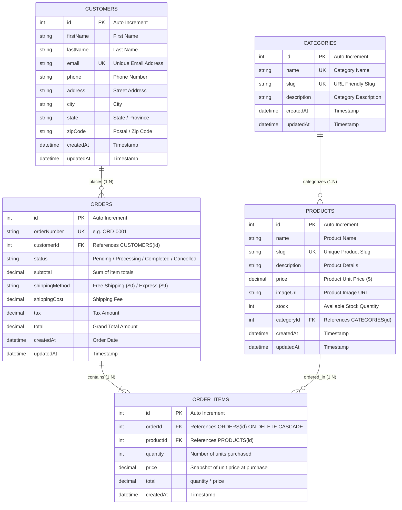

# 🗄️ DATABASE DESIGN SPECIFICATION (លំហាត់អនុវត្តទី៤៖ ERD & Database Design)

## 1. Overview
This document specifies the relational database schema designed for the practical exercises from `លំហាត់អនុវត្ត.pdf` (Practical Exercises 1, 2, 3 & 4).
The schema models a modern e-commerce ordering system adhering strictly to relational database principles, third normal form (3NF), data integrity constraints, and foreign key cascades.

---

## 2. Entity Relationship Diagram (ERD)



---

## 3. Relational Tables & Field Dictionaries

### 3.1 Table: `Customer` (`customers`)
Represents customer details captured during the checkout form (Exercise 2).
| Column Name | Data Type | Constraints | Description |
| :--- | :--- | :--- | :--- |
| `id` | `INTEGER` | PRIMARY KEY, AUTOINCREMENT | Unique customer identifier |
| `firstName` | `TEXT` | NOT NULL | Customer first name |
| `lastName` | `TEXT` | NOT NULL | Customer last name |
| `email` | `TEXT` | NOT NULL, UNIQUE | Customer contact email |
| `phone` | `TEXT` | NOT NULL | Contact phone number |
| `address` | `TEXT` | NOT NULL | Physical street address |
| `city` | `TEXT` | NOT NULL | City |
| `state` | `TEXT` | NOT NULL | State or Province |
| `zipCode` | `TEXT` | NOT NULL | Postal or Zip Code |
| `createdAt` | `DATETIME` | DEFAULT CURRENT_TIMESTAMP | Registration / record creation time |
| `updatedAt` | `DATETIME` | DEFAULT CURRENT_TIMESTAMP | Last updated time |

### 3.2 Table: `Category` (`categories`)
Organizes catalog products into logical departments.
| Column Name | Data Type | Constraints | Description |
| :--- | :--- | :--- | :--- |
| `id` | `INTEGER` | PRIMARY KEY, AUTOINCREMENT | Unique category identifier |
| `name` | `TEXT` | NOT NULL, UNIQUE | Category display name (e.g. "Electronics") |
| `slug` | `TEXT` | NOT NULL, UNIQUE | URL-friendly slug (e.g. "electronics") |
| `description`| `TEXT` | NULLABLE | Detailed description |
| `createdAt` | `DATETIME` | DEFAULT CURRENT_TIMESTAMP | Creation time |
| `updatedAt` | `DATETIME` | DEFAULT CURRENT_TIMESTAMP | Update time |

### 3.3 Table: `Product` (`products`)
Stores all store items (Laptop, Mouse, Keyboard, Monitor from Exercise 1).
| Column Name | Data Type | Constraints | Description |
| :--- | :--- | :--- | :--- |
| `id` | `INTEGER` | PRIMARY KEY, AUTOINCREMENT | Unique product identifier |
| `name` | `TEXT` | NOT NULL | Name (Laptop, Mouse, Keyboard, Monitor) |
| `slug` | `TEXT` | NOT NULL, UNIQUE | Unique identifier slug |
| `description`| `TEXT` | NULLABLE | Description and specifications |
| `price` | `REAL` / `DECIMAL` | NOT NULL | Price in USD ($650.00, $15.00, $25.00, $120.00) |
| `imageUrl` | `TEXT` | NULLABLE | High-resolution product image URL |
| `stock` | `INTEGER` | NOT NULL, DEFAULT 50 | Units in stock |
| `categoryId` | `INTEGER` | NOT NULL, FK -> Category(id) | Associated category |
| `createdAt` | `DATETIME` | DEFAULT CURRENT_TIMESTAMP | Creation time |
| `updatedAt` | `DATETIME` | DEFAULT CURRENT_TIMESTAMP | Update time |

### 3.4 Table: `Order` (`orders`)
Records purchases generated when customer submits the checkout form (Exercise 2 & 3).
| Column Name | Data Type | Constraints | Description |
| :--- | :--- | :--- | :--- |
| `id` | `INTEGER` | PRIMARY KEY, AUTOINCREMENT | Internal Order ID |
| `orderNumber`| `TEXT` | NOT NULL, UNIQUE | User-facing Order ID (e.g. "ORD-0001") |
| `customerId` | `INTEGER` | NOT NULL, FK -> Customer(id) | Customer who placed the order |
| `status` | `TEXT` | NOT NULL, DEFAULT "Pending" | Slide 28 requirement: "Pending" |
| `subtotal` | `REAL` | NOT NULL | Sum of all ordered line items |
| `shippingMethod` | `TEXT` | NOT NULL | "Free Shipping ($0)" or "Express Shipping ($9)" |
| `shippingCost` | `REAL` | NOT NULL, DEFAULT 0 | Shipping fee ($0 or $9) |
| `tax` | `REAL` | NOT NULL, DEFAULT 0 | Sales tax |
| `total` | `REAL` | NOT NULL | Grand Total = subtotal + shippingCost + tax |
| `createdAt` | `DATETIME` | DEFAULT CURRENT_TIMESTAMP | Order submission timestamp |
| `updatedAt` | `DATETIME` | DEFAULT CURRENT_TIMESTAMP | Order update timestamp |

### 3.5 Table: `OrderItem` (`order_items`)
Line items connecting products with orders.
| Column Name | Data Type | Constraints | Description |
| :--- | :--- | :--- | :--- |
| `id` | `INTEGER` | PRIMARY KEY, AUTOINCREMENT | Line item ID |
| `orderId` | `INTEGER` | NOT NULL, FK -> Order(id) ON DELETE CASCADE | Associated order |
| `productId` | `INTEGER` | NOT NULL, FK -> Product(id) | Purchased product |
| `quantity` | `INTEGER` | NOT NULL, CHECK(quantity > 0) | Quantity purchased |
| `price` | `REAL` | NOT NULL | Unit price at time of purchase |
| `total` | `REAL` | NOT NULL | Line total = quantity * price |
| `createdAt` | `DATETIME` | DEFAULT CURRENT_TIMESTAMP | Creation time |

---

## 4. Relationship Explanations (Cardinals)
1. **Category to Product (1:N)**:
   - One category can have many products.
   - Each product belongs to exactly one category (`categoryId`).
2. **Customer to Order (1:N)**:
   - One customer can place multiple orders over time.
   - Each order belongs to exactly one customer (`customerId`).
3. **Order to OrderItem (1:N)**:
   - One order contains one or more order items (`orderId`).
   - If an order is deleted, all corresponding `order_items` are deleted (`ON DELETE CASCADE`).
4. **Product to OrderItem (1:N)**:
   - One product can appear in multiple order items across different customer orders.
   - Preserves price snapshot in `OrderItem` so historical orders remain immutable even if the base product price changes later.

---

## 5. Prisma Schema (`prisma/schema.prisma`)

```prisma
datasource db {
  provider = "sqlite"
  url      = "file:./dev.db"
}

generator client {
  provider = "prisma-client-js"
}

model Customer {
  id        Int      @id @default(autoincrement())
  firstName String
  lastName  String
  email     String   @unique
  phone     String
  address   String
  city      String
  state     String
  zipCode   String
  orders    Order[]
  createdAt DateTime @default(now())
  updatedAt DateTime @updatedAt

  @@map("customers")
}

model Category {
  id          Int       @id @default(autoincrement())
  name        String    @unique
  slug        String    @unique
  description String?
  products    Product[]
  createdAt   DateTime  @default(now())
  updatedAt   DateTime  @updatedAt

  @@map("categories")
}

model Product {
  id          Int         @id @default(autoincrement())
  name        String
  slug        String      @unique
  description String?
  price       Float
  imageUrl    String?
  stock       Int         @default(50)
  categoryId  Int
  category    Category    @relation(fields: [categoryId], references: [id])
  orderItems  OrderItem[]
  createdAt   DateTime    @default(now())
  updatedAt   DateTime    @updatedAt

  @@map("products")
}

model Order {
  id             Int         @id @default(autoincrement())
  orderNumber    String      @unique
  customerId     Int
  customer       Customer    @relation(fields: [customerId], references: [id])
  status         String      @default("Pending")
  subtotal       Float
  shippingMethod String      @default("free")
  shippingCost   Float       @default(0.0)
  tax            Float       @default(0.0)
  total          Float
  items          OrderItem[]
  createdAt      DateTime    @default(now())
  updatedAt      DateTime    @updatedAt

  @@map("orders")
}

model OrderItem {
  id        Int      @id @default(autoincrement())
  orderId   Int
  order     Order    @relation(fields: [orderId], references: [id], onDelete: Cascade)
  productId Int
  product   Product  @relation(fields: [productId], references: [id])
  quantity  Int
  price     Float
  total     Float
  createdAt DateTime @default(now())

  @@map("order_items")
}
```

---

## 6. Seed Data (Exercise 1 Products)
The initial seed data populates the exact 4 products required by Practical Exercise 1:
1. **Laptop** - `$650` (Category: Computers)
2. **Mouse** - `$15` (Category: Accessories)
3. **Keyboard** - `$25` (Category: Accessories)
4. **Monitor** - `$120` (Category: Displays)
